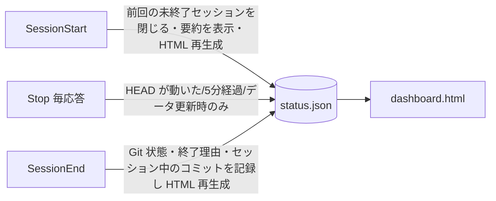

# progress-dashboard

人間がセッション履歴を読み返さなくても、現在の状況、判断の理由、次の作業を把握できるようにする。
記録はClaudeが作業の節目でCLIを1行実行して残す。Hookは記録済みデータからHTMLを作り直すだけで、LLMは呼ばない。

```bash
P=~/.claude/skills/progress-dashboard/scripts/progress.py
python3 $P show        # 短い要約（SessionStart で自動表示されるものと同じ）
```

`$P`はプロジェクト内のどこから実行してもよい。上位ディレクトリの`.claude/dashboard/status.json`を探して使う。

## 導入（プロジェクトごとに1回）

```bash
python3 $P init --goal "このプロジェクトで達成したいこと"
```

`.claude/dashboard/`に`status.json`、`decisions.json`、`dashboard.html`、`.gitignore`ができる。
`status.json`と`decisions.json`はコミットしてよい。`dashboard.html`、`hook.log`、`.lock`は`.gitignore`で除外済み。
このディレクトリが無いプロジェクトでは、Hookは何もせずに終了する。

### 残件と判断の正本が既にあるプロジェクト

`notes/remaining.md`のような残件表と、notesの「決めたこと」の表で管理しているプロジェクトでは、ダッシュボードを正本の表示だけに使う。

```bash
python3 $P init --tasks-from notes/remaining.md --decisions-from notes --goal "..."
echo ".claude/dashboard/" >> .git/info/exclude   # チームのリポジトリには入れない
```

- 残件は、1列目がID（A1、P3など）の表の行だけを読む。状態は規約の印から決める。`~~項目~~`と「済」、または「済 (」で始まる欄は完了、「やらない」は中止、B節は外部待ち、印の無いものは未完。
- 判断は、見出しが「決めたこと」で始まる節の`| # | 項目 | 決定 |`の表を読む。
- `task`、`blocker`、`next`、`decision`のコマンドは拒否される。残件や判断を変えるときは正本を編集する。正本を書き換えると、次のStopでHTMLが作り直される。
- progress.pyで記録するのは、正本が扱わないテスト結果（`test`）、方針変更（`note --pivot`）、セッションの要約（`summary`）だけ。

## いつ何を記録するか

| 起きたこと | コマンド |
| --- | --- |
| 新しい作業が決まった | `python3 $P task add "タイトル"` |
| 作業に着手した | `python3 $P task set T3 doing` |
| 実装したが、まだ確かめていない | `python3 $P task set T3 unverified --note "残っている確認"` |
| 確認まで終えた | `python3 $P task set T3 done --evidence "pytest tests/test_x.py が成功"` |
| 作業を止める問題が見つかった | `python3 $P task set T3 blocked --note "理由"` または `python3 $P blocker add "内容" --task T3` |
| 問題が解消した | `python3 $P blocker resolve B1 --resolution "どう解消したか"` |
| テストや動作確認を実行した | `python3 $P test "名前" pass\|fail\|skip --cmd "実行したコマンド" --detail "要点"` |
| 後から理由を問われそうな判断をした | `python3 $P decision add --title ... --decision ... --reason ... --alt "案: 採らなかった理由" --assume "前提" --ref path/or/commit` |
| 判断を覆した | 新しい判断を `decision add` してから `python3 $P decision supersede D2 --by D5` |
| 次にやることが決まった・終わった | `python3 $P next add "内容"` / `python3 $P next done N2` |
| 作業方針を変えた | `python3 $P note --pivot "何から何へ変えたか、その理由"` |
| セッションの区切り（任意） | `python3 $P summary "このセッションでやったことを2〜3文で"` |

1回の応答で記録が複数あれば、まとめて続けて実行する。記録だけのために応答を増やさない。

## 守ること

- 実際に確認した事実だけを書く。実行していないテストは`pass`にしない。実行できなかったものは`skip`にして理由を`--detail`に書く。
- `done`には確認方法の`--evidence`が必須。確かめていないものは`unverified`のままにする。
- 秘密情報（トークン、パスワード、鍵、社外秘の値）は書かない。CLIもよくある形式を`[REDACTED]`に置き換えるが、それに頼らない。
- 説明文（タイトル、理由、要約）はexplain-before-shortenとyomiyasuの方針で書く。何がどうなったかが1文で分かるようにし、比喩や前置きを入れない。
- JSONを直接編集しない。CLIはロックと原子的な置き換えで書き込むため、複数セッションが同時に動いても壊れない。

## 自動で行われること（Claude CodeのHook）



- SessionStart: 短い要約を会話の先頭に入れ、`PROGRESS_SESSION_ID`をシェル環境に設定する。SessionEndが届かず30分以上応答のないセッションは「終了記録なし」として閉じる（herdrなどで並行するセッションは閉じない）。
- Stop: 条件に当たったときだけ書き込む。応答をブロックしないので、再帰実行は起きない。
- SessionEnd: Gitの状態を確認して最終更新日時を記録し、HTMLを作り直す。
- どのHookも失敗時は`.claude/dashboard/hook.log`に書いて終了コード0で抜けるので、開発作業は止まらない。

ダッシュボードを開く: `xdg-open .claude/dashboard/dashboard.html`（手動で作り直すなら`python3 $P render`）。

## 全プロジェクトをまとめて見る（serve.py）

`init`、`render`、SessionStartのたびに、プロジェクトは`~/.local/state/progress-dashboard/projects.json`に登録される。
`scripts/serve.py`は登録されたプロジェクトを1つのサーバーで配信するので、プロジェクトが増えてもポートは1つで済む。

- `/`は全プロジェクトの一覧で、対応が必要なものから順に並ぶ。`/p/<slug>/`は各プロジェクトのダッシュボード。
- 配信するのは`dashboard.html`と一覧だけで、`status.json`、`decisions.json`、`hook.log`は返さない。
- `status.json`を消したプロジェクトは一覧から消える。
- 常駐は`systemd/progress-dashboard.service`（systemdのユーザーサービス）で行う。既定の待ち受けは127.0.0.1だけで、LANにも出すときは`~/.config/progress-dashboard/serve.env`に`PROGRESS_DASHBOARD_EXTRA_ARGS=--bind <LANのアドレス>`を書く。

LANに出している場合、登録したプロジェクトは同じLANにいる人なら誰でも開ける。公開したくないリポジトリでは`init`しない。
一覧から外すには、そのプロジェクトで`python3 $P unregister`を実行する。`.claude/dashboard/`が残っていると次のSessionStartで再び登録されるので、使わなくなったプロジェクトではディレクトリごと消す。

## あなたの対応待ち（agents.py）

ハブの一覧の最上部に、このマシンで動いているClaude Codeのセッションのうち、ユーザーを待っているものを出す。herdrの中か外か、`init`したリポジトリかどうかは問わない。

- 状態はHookのイベントから決める。UserPromptSubmitとPostToolUseで作業中、PermissionRequestとAskUserQuestionで承認・回答待ち、Stopで応答済み、Notificationのidle_promptで指示待ちになる。SessionEndで消える。
- 状態ファイルは`~/.local/state/progress-dashboard/agents/<session_id>.json`。プロンプトの本文とツールの入力は保存しない（LANに出るため）。保存するのはプロジェクトのパス、ブランチ、待っている内容の見出し、時刻、herdrのペインID、Claude本体のPID。
- PostToolUseは全ツールで発火するので、待ち状態のセッションがあるときだけ置く目印（`*.waiting`）をbashで確かめ、無ければPythonを起動しない。
- 強制終了したセッションは、PIDとプロセスの起動時刻が一致しなくなった時点で一覧から外す。
